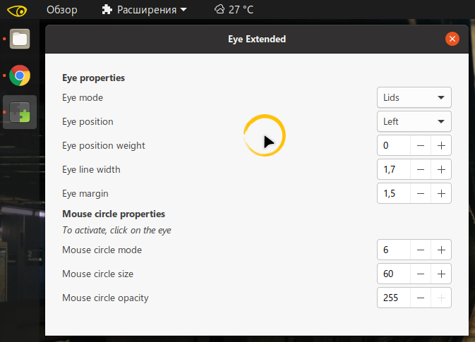

## Eye and Mouse Extended Extension

 

This is Fork at https://extensions.gnome.org/extension/213/eye/

The extension adds an eye to the indicator bar that follows your cursor.

Documentation for anyone stumbling across this repo:

* http://smasue.github.io/gnome-shell-tw
* https://gjs.guide/extensions/upgrading/gnome-shell-40.html#show-all-and-destroy

## Installation

1. `git clone https://github.com/alexeylovchikov/eye-extended-shell-extension.git`
2. `./scripts/install.sh`

3. Log out and back in, then enable it with the Extensions app or `gnome-extensions enable eye-extended@als.kz`.

## Compatibility

* GNOME Shell 45–51: current `master`.
* GNOME Shell 40–44: use commit `5c136ff` (the last release before the switch to ES modules).
