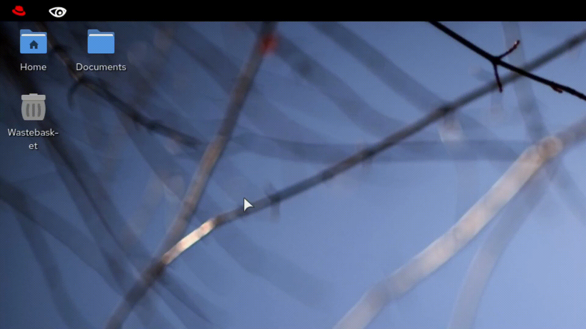
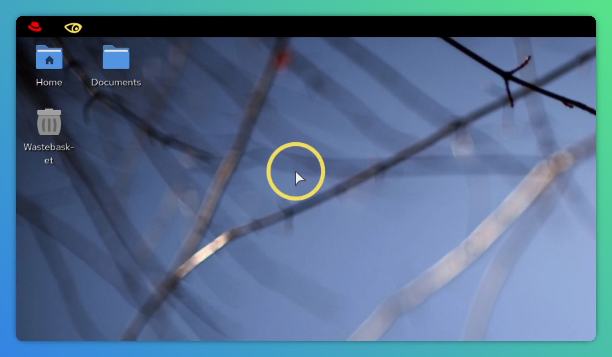
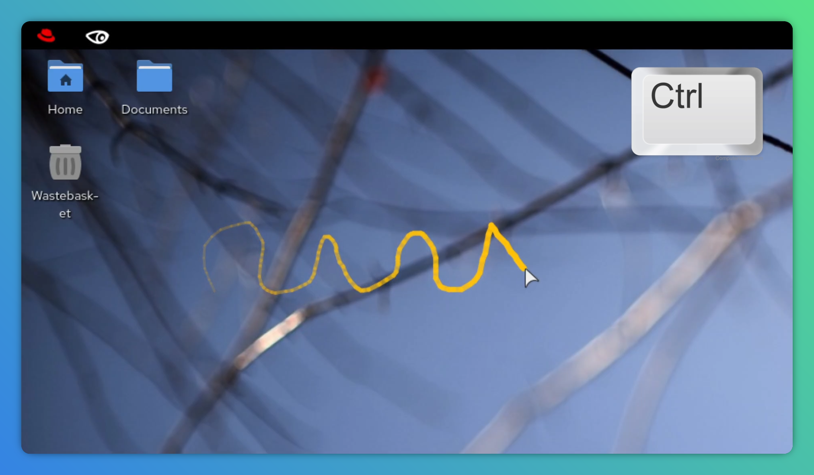
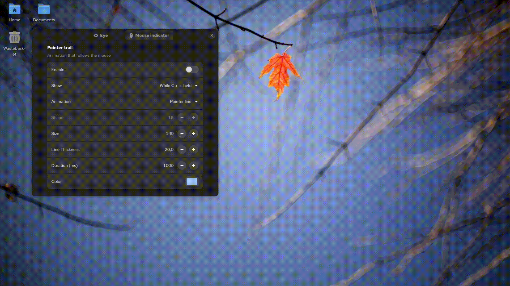

<div align="center">


# Eye and Mouse Extended

**A GNOME Shell extension that keeps the cursor easy to find**: an eye in the top panel
that follows the pointer, a mouse indicator that highlights clicks, and pointer
animations that follow the pointer, always or only while <kbd>Ctrl</kbd> is held.<br>
Made for screen recordings, presentations, screen sharing and large monitors.

[](#compatibility)
[](LICENSE)


[](#translations)

[Installation](#installation) · [Settings](#settings) · [Compatibility](#compatibility) · [Translations](#translations)

</div>



## Features

### Eye in the top panel

The eye watches the cursor wherever it goes. Choose a round eye or an eye with lids,
and set its size, line thickness, margin and place in the panel.

### Mouse indicator

Click the eye to turn the indicator on or off. A shape follows the cursor and changes
color on left, right and middle clicks, so viewers can see what you click.
While the indicator is on, the eye takes its color.



### Pointer trail

Hold <kbd>Ctrl</kbd> and move the mouse to point at something on the screen.
The trail can also be shown all the time, without <kbd>Ctrl</kbd>.
It works anywhere, even when the mouse indicator is off, and can be turned
on and off from the right-click menu of the eye.



| Animation | What it does |
|---|---|
| Water ripples | Rings spread out behind the cursor, like a finger moving through water |
| Pointer line | A line follows the cursor and fades away, like a laser pointer |
| Comet tail | A tail of dots that shrink and disappear |
| Sparkles | Small pieces scatter around the cursor |

The trail settings in action: switching between **While Ctrl is held** and **Always**,
and between the animations.



## Installation

1. Clone the repository:

   ```bash
   git clone https://github.com/alexeylovchikov/eye-extended-shell-extension.git
   cd eye-extended-shell-extension
   ```

2. Build and install the extension with translations:

   ```bash
   ./scripts/install.sh
   ```

3. Log out and back in.
4. Enable the extension in the Extensions app or with:

   ```bash
   gnome-extensions enable eye-extended@als.kz
   ```

To update, pull the latest changes and repeat steps 2 and 3.

## Settings

To open the settings, do one of the following:

1. Click the eye with the right mouse button and choose **Settings**. The menu also has a **Pointer trail** switch.
2. Open the Extensions app and click the gear next to **Eye and Mouse Extended**.
3. Run:

   ```bash
   gnome-extensions prefs eye-extended@als.kz
   ```

Changes apply immediately, without logging out.

### Eye tab

| Setting | Default | Description |
|---|---|---|
| Shape | Eyelid | **Round** draws an eyeball, **Eyelid** draws an eye with lids. |
| Location | Left | Part of the top panel the eye is placed in: **Left**, **Center** or **Right**. |
| Position | 0 | Order among the other icons in the same part of the panel, from −255 to 255. |
| Size | 16 | Eye height in pixels, from 8 to 64. The eye never grows taller than the panel. |
| Line Thickness | 1.5 | Width of the eye outline in pixels. |
| Margin | 1.5 | Empty space on both sides of the eye in pixels. |
| Refresh interval (ms) | 100 | How often the eye checks the pointer position. Lower is smoother, higher uses less CPU. |

### Mouse indicator tab: indicator

The indicator is turned on and off by clicking the eye with the left mouse button.

| Setting | Default | Description |
|---|---|---|
| Enable | On | Shows the shape around the cursor. When it is off, clicks are still highlighted. |
| Shape | 1 | One of the 19 shapes from the [circle](eye-extended@als.kz/circle) folder. |
| Size | 60 | Shape size in pixels, from 1 to 500. |
| Opacity | 200 | From 1 (almost invisible) to 255 (fully opaque). |
| Refresh interval (ms) | 10 | How often the indicator follows the pointer and checks the mouse buttons. |
| Enable left / right / middle click coloring | On | Recolors the shape and shows a short flash on click of that button. |
| Default |  | Shape color when no button is pressed. The eye uses it too while the indicator is on. |
| Left click |  | Color on left click. |
| Right click |  | Color on right click. |
| Middle click |  | Color on middle click. |

### Mouse indicator tab: Pointer trail

| Setting | Default | Description |
|---|---|---|
| Enable | On | Draws the animation behind the pointer. The same switch is in the right-click menu of the eye. |
| Show | While Ctrl is held | **While Ctrl is held** draws the trail only when <kbd>Ctrl</kbd> is pressed, **Always** draws it whenever the mouse moves. |
| Animation | Water ripples | **Water ripples**, **Pointer line**, **Comet tail** or **Sparkles**. |
| Shape | 0 | 0 draws a plain ring or dot, 1–19 use the mouse indicator shapes. Not used by **Pointer line**. |
| Size | 80 | Overall size of the effect in pixels. A ripple starts exactly as big as a mouse indicator of the same size, comet dots are a quarter of it, and sparkles fly up to half of it. |
| Line Thickness | 3 | Ring outline for **Water ripples** and line width for **Pointer line**, in pixels. |
| Duration (ms) | 900 | How long each piece of the trail takes to fade away. |
| Color |  | Trail color. |

### Settings from the command line

All settings are stored in GSettings under `org.gnome.shell.extensions.eye-extended`.
You can read and change them from a terminal, for example:

```bash
gsettings --schemadir ~/.local/share/gnome-shell/extensions/eye-extended@als.kz/schemas \
    set org.gnome.shell.extensions.eye-extended water-ripple-effect 'line'
```

To reset all settings to their defaults:

```bash
dconf reset -f /org/gnome/shell/extensions/eye-extended/
```

## Compatibility

| GNOME Shell | Version to use |
|---|---|
| 45–51 | current `master` |
| 40–44 | commit `5c136ff`, the last release before the switch to ES modules |

On Wayland, GNOME Shell does not see input sent to application windows, so the extension
polls the pointer and keyboard state instead. Clicks and <kbd>Ctrl</kbd> are detected
in application windows, in the shell UI and on X11.

If **Locate Pointer** is turned on in Settings → Accessibility, a single press of
<kbd>Ctrl</kbd> also shows the GNOME pointer animation.

## Translations

The settings are translated into German, French, Dutch and Russian; the files are in
[translations](translations). To add a language:

1. Copy `translations/EyeExtendedExtension.pot` to `translations/<language>.po`.
2. Translate the strings, for example in Poedit.
3. Run `./scripts/install.sh` to check the result and open a pull request.

## Credits

This is a fork of [Eye](https://extensions.gnome.org/extension/213/eye/) for GNOME Shell,
with contributions from everyone in the project history.

Useful documentation for GNOME Shell extension development:

- [GJS Guide: extensions](https://gjs.guide/extensions/)
- [Porting extensions to GNOME Shell 45](https://gjs.guide/extensions/upgrading/gnome-shell-45.html)

## License

[GPL-3.0](LICENSE)
